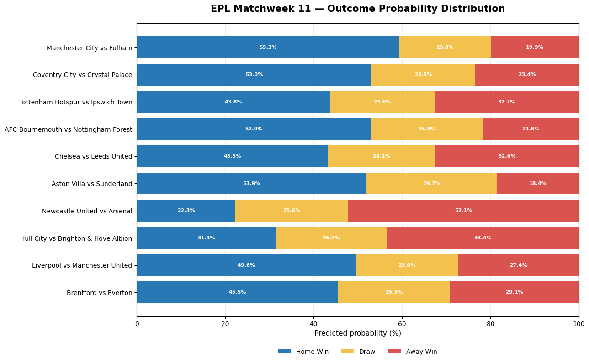
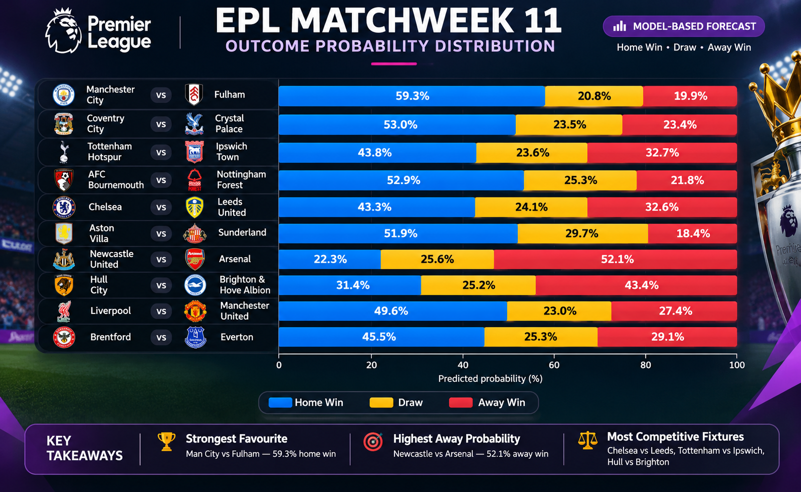
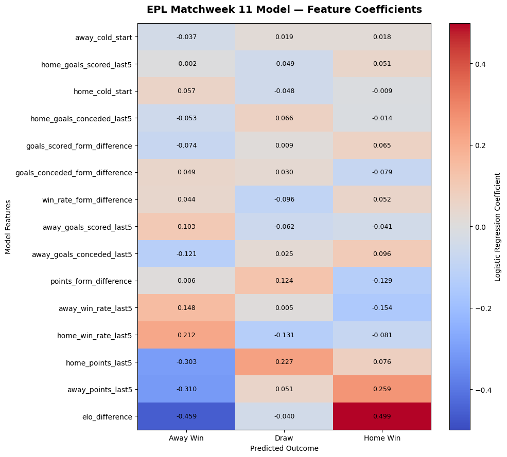

# EPL Match Outcome Prediction ⚽📊

### A Machine Learning Approach to Premier League Match Forecasting

## Project Overview

This project develops a machine learning framework to estimate the probabilities of three possible English Premier League match outcomes:

- Home Win
- Draw
- Away Win

Using historical Premier League data from the 2018/19 to 2025/26 seasons, the project combines Elo ratings, recent team performance, goalscoring trends and defensive indicators to generate probability-based match forecasts.

The objective is not simply to predict winners, but to quantify uncertainty and understand the factors influencing each prediction.

## Explore the Analysis

The complete Matchweek 11 forecasting workflow is available in the Jupyter Notebook:

https://github.com/stephen1-hub/epl-match-outcome-prediction/blob/main/05_matchweek_11_forecasting.ipynb

The notebook covers data preparation, Elo ratings, feature engineering, model evaluation, probability forecasting and model interpretation.

## Project Objectives

- Build a historical EPL match dataset covering eight seasons.
- Develop team strength ratings using an Elo rating system.
- Engineer rolling team performance and recent-form features.
- Train and evaluate multiclass classification models.
- Estimate Home Win, Draw and Away Win probabilities.
- Analyse model coefficients and feature relationships.
- Visualise match-level probability distributions.
- Develop an explainable football forecasting framework.

## Data Coverage

| Dataset component | Coverage |
|---|---|
| Historical seasons | 2018/19–2025/26 |
| Historical matches | 3,040 |
| Historical teams | 30 |
| Current season | 2026/27 |
| Completed current-season matches | 100 |
| Matchweek forecast | Matchweek 11 |
| Matchweek 11 fixtures | 10 |

## Data Preparation and Feature Engineering

The model uses 15 engineered features covering team strength, recent performance and early-season conditions.

### 1. Elo Ratings

An Elo rating system was reconstructed across historical seasons and carried forward into 2026/27.

The rating framework incorporates:

- Initial team ratings
- Home advantage
- K-factor adjustments
- Previous-season rating carryover
- Regression towards the baseline rating
- Current-season match results

The Elo difference feature represents the relative strength advantage between the home and away teams, including the model's home-advantage adjustment.

### 2. Recent Form

Rolling performance indicators were developed using the previous five matches.

Examples include:

- Points earned per match
- Goals scored per match
- Goals conceded per match
- Win rate

Features were calculated using previous matches only to avoid future-information leakage.

### 3. Additional Features

Cold-start indicators were included to represent early-season information availability.

### Model Features

The final model uses the following 15 features:

1. `elo_difference`
2. `home_points_last5`
3. `home_goals_scored_last5`
4. `home_goals_conceded_last5`
5. `home_win_rate_last5`
6. `away_points_last5`
7. `away_goals_scored_last5`
8. `away_goals_conceded_last5`
9. `away_win_rate_last5`
10. `points_form_difference`
11. `goals_scored_form_difference`
12. `goals_conceded_form_difference`
13. `win_rate_form_difference`
14. `home_cold_start`
15. `away_cold_start`

## Model Development

Several classification approaches were evaluated, including:

- Logistic Regression
- Random Forest
- HistGradientBoosting

A chronological validation strategy was used to preserve the time-based structure of football data.

### Dataset Split

| Dataset | Seasons | Matches |
|---|---|---:|
| Training | 2018/19–2023/24 | 2,280 |
| Validation | 2024/25 | 380 |
| Held-back test period | 2025/26 | 380 |

The 2025/26 test period was kept separate during model selection.

### Selected Model: Logistic Regression

The 15-feature Logistic Regression model was selected after comparison with the original 17-feature version.

Validation results:

| Metric | 15-feature model |
|---|---:|
| Accuracy | 0.5184 |
| Log Loss | 0.9895 |
| Brier Score | 0.5936 |

The 15-feature model achieved the same validation accuracy as the 17-feature model, with slightly better Log Loss and Brier Score.

Following model selection, the final forecasting model was fitted using all 3,040 historical matches.

**Note:** The reported metrics are validation results, not independent test-set performance. The final model's performance on future matches remains to be established.

## Matchweek 11 — 2026/27 Forecast

The selected model generated probability estimates for ten Premier League fixtures.

### Selected Forecasts

| Fixture | Home Win | Draw | Away Win |
|---|---:|---:|---:|
| Manchester City vs Fulham | 59.29% | 20.82% | 19.89% |
| Coventry City vs Crystal Palace | 53.04% | 23.54% | 23.43% |
| Tottenham vs Ipswich | 43.75% | 23.58% | 32.66% |
| Bournemouth vs Nottingham Forest | 52.88% | 25.33% | 21.79% |
| Chelsea vs Leeds | 43.31% | 24.11% | 32.58% |
| Aston Villa vs Sunderland | 51.85% | 29.70% | 18.44% |
| Newcastle vs Arsenal | 22.32% | 25.55% | 52.13% |
| Hull City vs Brighton | 31.38% | 25.18% | 43.44% |
| Liverpool vs Manchester United | 49.56% | 23.03% | 27.41% |
| Brentford vs Everton | 45.55% | 25.31% | 29.14% |

### Key Observations

- Manchester City vs Fulham had the highest home-win probability at 59.29%.
- Arsenal had the highest away-win probability at 52.13% against Newcastle.
- Aston Villa vs Sunderland had the highest draw probability at 29.70%.
- Chelsea vs Leeds, Tottenham vs Ipswich and Hull vs Brighton showed relatively competitive probability distributions.

All ten probability distributions were validated to approximately 100%, allowing for rounding.

## Model Interpretation

Logistic Regression coefficients were extracted and visualised using a diverging heatmap.

Key observations:

- Elo difference was the strongest directional coefficient signal.
- Recent away-team points and home-team points also showed substantial coefficients.
- Goalscoring and defensive indicators contributed additional information.
- Cold-start features had comparatively small coefficients.

These coefficients describe model relationships, not causal effects or standalone feature importance.

## Visualisations

### Matchweek 11 — Probability Distribution



### Matchweek 11 — Forecast Infographic



### Logistic Regression — Feature Coefficients



## Technology Stack

- Python
- Pandas
- NumPy
- Scikit-learn
- Matplotlib
- Seaborn
- Jupyter Notebook / Google Colab
- Git and GitHub

## Project Structure

```text
epl-match-outcome-prediction/
│
├── data/
│   ├── raw/
│   └── processed/
│
├── notebooks/
│   ├── 01_data_exploration.ipynb
│   ├── 02_feature_engineering.ipynb
│   ├── 03_elo_rating_engine.ipynb
│   ├── 04_model_training_evaluation.ipynb
│   └── 05_matchweek_11_forecasting.ipynb
│
├── images/
│   ├── mw11_probability_distribution.png
│   └── feature_coefficient_heatmap.png
│
├── models/
│
├── reports/
│
├── src/
│
├── requirements.txt
└── README.md
```

## Limitations and Future Improvements

This project is an ongoing forecasting experiment.

Potential improvements include:

- Probability calibration and reliability analysis.
- Match-level prediction explanations.
- Feature importance using permutation importance.
- SHAP-based model interpretation.
- Independent evaluation on future matchweeks.
- Comparison with bookmaker-implied probabilities.
- Model retraining as new match data becomes available.
- Development of an interactive Streamlit forecasting dashboard.

## Conclusion

This project explores how historical football performance, team strength and recent form can be translated into probabilistic match forecasts.

Rather than treating football outcomes as certainties, it focuses on estimating uncertainty, identifying patterns and making the reasoning behind predictions more transparent.

**The Football Data Room — Where football meets evidence.**

---

*Disclaimer: These forecasts are experimental model outputs for football analytics and research. They are not guarantees of match outcomes or betting recommendations.*
